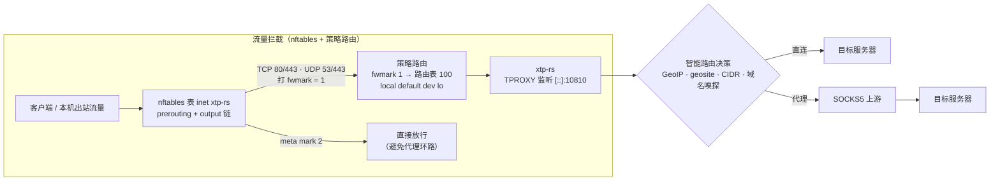
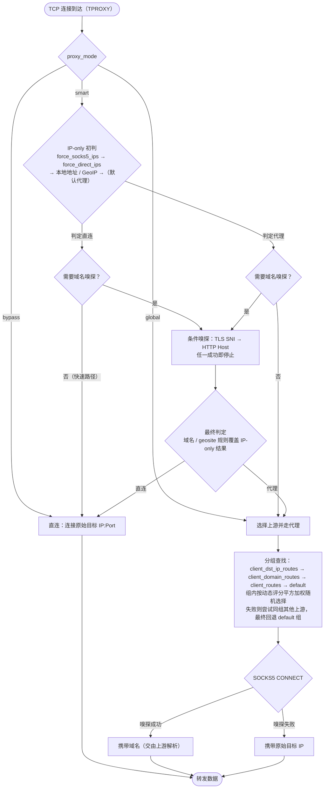
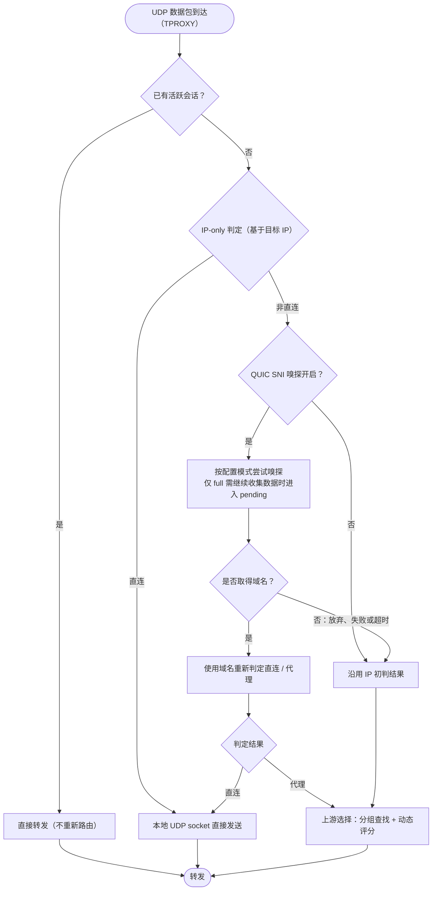

# 工作原理

> [← 返回 README](../README.md) · 相关：[配置参考](./配置.md) · [部署](./部署.md) · [OpenWrt 部署](./OpenWrt.md)

本文描述 xtp-rs 的流量走向、路由决策、上游评分与 TCP relay 半关闭回收机制。配置项含义见 [配置参考](./配置.md)。

---

## 一、整体架构



> [!WARNING]
> **fwmark 约定**：`fwmark = 1`（`XTP_FWMARK`）由 nftables 设置，标记“待代理”的入站流量；`fwmark = 2`（`XTP_BYPASS_MARK`）由 xtp-rs 设置，标记“已代理 / 直连”的出站流量。配置文件中的 `fwmark` 必须与脚本的 `XTP_BYPASS_MARK` 一致，默认均为 `2`，且不得与 `XTP_FWMARK` 相同。配置错误可能使程序自身的出站流量被再次截获，形成代理环路，导致相关连接无法正常建立。

---

## 二、路由优先级（smart 模式）

在 `smart` 模式下，路由决策按以下优先级从高到低执行（命中即返回）：

| 优先级 | 规则 | 相关配置 |
|:---:|------|----------|
| 1 | 域名强制规则 | `force_socks5_domains` → `force_direct_domains` |
| 2 | geosite 域名分类 | `proxy_geosite_tags` → `direct_geosite_tags` |
| 3 | 路由缓存 | 缓存由 IP 规则与 GeoIP 得出的结果（域名规则不写缓存） |
| 4 | IP 强制规则 | `force_socks5_ips` → `force_direct_ips` |
| 5 | 本地地址 / GeoIP 国家 | `direct_local_ip`（回环 / 链路本地）与 `direct_countries`（默认 `["CN"]`）在同一判定层 |

几个要点：

- **在取得域名并执行域名判定时，域名规则优先于 IP 规则**：例如目标 IP 属于中国大陆，但域名命中 `force_socks5_domains` 或 `proxy_geosite_tags` 时，仍会走代理；反之，域名直连规则也可以将 IP 初判的代理结果改为直连。UDP 路径存在跳过嗅探的情况，详见下文。
- **geosite 内部先 proxy 后 direct**：同一域名同时命中两边时代理胜出，所以 `direct_geosite_tags` 要保守。
- **路由缓存**：由 IP 规则与 GeoIP 得出的结果会写入缓存（TTL 由 `route_cache_ttl_secs` 控制，容量由 `route_cache_max` 控制），后续相同目标直接复用；**域名规则的结果不写缓存**（每次都现算，保证专线规则即时生效）。

域名规则支持两种格式：

| 格式 | 匹配方式 |
|------|----------|
| `.example.com` | 后缀匹配：匹配 `example.com` 及其所有子域名 |
| `example.com` | 精确匹配：仅匹配 `example.com` |

> [!TIP]
> 例如排除 PlayStation 流量不走代理：
>
> ```toml
> force_direct_domains = [".playstation.com", ".sony.com", ".playstation.net"]
> ```

---

## 三、TCP 连接处理流程



**触发域名嗅探的条件**（满足任一即需要）：

- 配置了域名强制规则（`force_direct_domains` 或 `force_socks5_domains` 非空）；
- 配置了 geosite（`geosite_path` 非空）**且** `proxy_geosite_tags` 或 `direct_geosite_tags` 非空，且处于 `smart` 模式；
- 配置了 `client_domain_routes` 且当前客户端 IP 命中其中的 CIDR（仅在 IP 初判为“非直连”时触发）。

前两类在直连与代理路径上都会嗅探，用于纠正 IP 层的误判；第三类只在需要按域名分组时才触发。若对应 sniff 功能未编译或未在配置中开启，嗅探会直接返回空结果。

---

## 四、UDP 数据包处理流程



> [!IMPORTANT]
> **TCP 与 UDP 嗅探的差异**：
> - TCP 嗅探结果参与**直连 / 代理决策**（重新按 geosite 和域名强制规则判定）。
> - UDP 嗅探结果**同样参与直连 / 代理决策**：建会话时会以嗅探到的域名调用 `should_direct(ip, domain)`，因此域名规则可以将“IP 初判代理”的判定结果改为直连；嗅探结果还会影响 SOCKS5 UDP 目标地址（用域名还是 IP）与上游分组选择。
> - 但 **IP 初判为直连的 UDP 流会短路跳过嗅探**（内网、保留地址等无需重组），因此嗅探无法将“IP 直连”的判定结果改为代理。
> - 会话建立后，所采用的路由和目标地址形式（域名或 IP）不再改变；后续数据包即使提供了新的域名信息，也不会改变该会话的路由。

QUIC 嗅探模式（`quic_sniff_mode`）见 [配置参考](./配置.md#quic-嗅探模式)。其中 `full` 模式的 pending 缓存等待时限由 `quic_sniff_pending_timeout_ms` 控制（默认 **200 ms**），仅当 ClientHello 跨包时才需要缓存等待；首包即可完成嗅探时解析后直接转发，不进入 pending。

---

## 五、上游动态评分机制

xtp-rs 给每条上游维护一个动态分，来自两个信息源，再经加权、惩罚与平方加权随机完成选路。

### 5.1 TCP 吞吐分（自动）

通过 `TCP_INFO` **每 2 秒**采样一次每条上游的 SOCKS5 连接，按 fd 记录累计字节的基线，只统计**下行** `tcpi_bytes_received`。被追踪的 fd 是 xtp-rs 到本机 SOCKS5 的 loopback 连接，上行的 `bytes_acked` 反映的是本地进程排空发送缓冲的速度（受其 send-window 支配），与远端上行带宽无关，计入会把上传偏重的链路分数虚高。

- **只有真在传数据的连接参与统计**：本窗口下行增量 ≥ 4 KB 的连接才计入，空闲 keep-alive 与偶发心跳不进速率分母。
- **速率取字节加权均值**：`Σd² / (Δt · Σd)`，等价于「每连接速率按它搬的字节数加权」。一条大流不会被旁边一堆小请求拉低，也不像聚合总量那样随并发连接数放大——后者会形成「被选越多、并发越多、聚合越高、分越高」的正反馈，衡量的是负载而不是能力。单连接时退化为该连接自身的速率。
- **新旧混合**：样本新鲜时按 **50/50** 混合；首次采样，或距上次更新已超过 `quic_stale_secs` 时直接覆盖，避免陈年旧值把重启后的第一个样本拉偏一半。
- **无样本不降分**：连续几个采样窗口都没有连接传数据时保留上一次实测值，不向 0 衰减；否则空闲链路会在十几个采样周期内被逐轮折半打到地板。

样本总量低于 16 KB 时不更新，避免噪声。绝对分段评分模式下，上述速率再经 `calc_throughput_score` 映射成 0~1000。

### 5.2 QUIC 探针分（被动接收）

ShadowQUIC 的链路质量（RTT、丢包率、MTU）由 `xtp-stats-reporter` 采集后经 Unix 数据报 socket 上报（部署见 [OpenWrt 部署](./OpenWrt.md#五xtp-stats-reporter-shadowquic-性能上报)）。取数只走 ShadowQUIC 的 RESTful API：轮询 `/api/v1/outbounds` 拿采样，并用 probe 端点喂流量；ShadowQUIC 配置里没有 `restful-api:` 段时该 daemon 直接报错退出，没有日志回落路径。分数由 RTT / 丢包率 / MTU 综合计算，新旧按 **30/70** 混合（新数据占七成，响应快又不至于抖动），上行 / 下行链路独立评分；探针分更新有 5 秒冷却。

### 5.3 衰减与合成

- **衰减**：QUIC 探针分数在 `quic_stale_secs`（默认 180 秒）未更新后**线性衰减到最低分 10**，避免探针断流导致上游长期无法被选中。
- **合成**：`总分 = TCP 分 × (100 - quic_weight)% + QUIC 分 × quic_weight%`（`quic_weight` 默认 40）。只有 TCP 分时直接用它；只有探针分时取 `min(QUIC 分, 零证据上限)`；两路都无效时按**基础分 75**。
- **零证据链路上限**：还没有任何吞吐样本、只有探针分的上游会被限幅，默认上限 500。探针只测 RTT / 丢包 / MTU，与吞吐相关性弱；不限幅会让从未跑过数据的链路凭探针分拿到最高权重，把新连接全部吸走、自己反而永远拿不到吞吐样本。相对模式下该上限按组动态计算，见 5.4。
- **惩罚与基础分**：新上游与连接失败被惩罚的上游统一使用基础分 75，有效分下限为 1，保证所有上游都有机会被选中。健康检查恢复后会把该上游的 TCP 分重置为 300。
- **选路权重**：`有效分 = 总分 × gain`，采用**平方加权随机**选择（`权重 = 有效分²`，高分优势放大）。探索空间由两条机制保留：5% 概率从未初始化的上游里均匀选取，以及零证据链路的分数上限。

### 5.4 相对归一化模式

`enable_relative_scoring = true`（默认关闭）时，评分口径从“绝对阈值分段”改为“跨链路相对归一化”，适配光纤 / 4G / 卫星等异构网络：

- 每 `relative_rescore_interval_secs`（默认 2 秒）重算一次：把每条上游的吞吐速率与探针质量相对**同组最大值的指数移动平均（EMA）** 归一化到 0~1000，组内最优得满分，其余按比例得分。归一化按 `groups` 分别进行（选路本来就在组内取候选池，用全局最大值会把弱组整组压扁）；同一条上游属于多个组时，取各组相对分的平均。
- **无样本保留旧分**：本轮没有速率样本的链路不更新 TCP 分，也不会向 0 衰减。还没有任何样本的链路保持「未初始化」，不写入任何乐观先验——没有证据就不该参与排序，改由下面的探索机制取样。
- **零证据上限按组动态计算**：`上限 = 组内最佳实测分 / 3`，夹在 100~500。平方加权下这相当于让组内最佳实测链路拿到约 2/3 权重，其余留给探索。取 1/3 而不是更大的系数，是因为上限必须低于实测分才起作用；下限 100 保证组内唯一实测链路本身很差时不会把探索空间掐死。多组上游取各组的**最小值**（最保守），代价是它在「全未测组」里的权重会低于该组的纯本组链路。组内没有任何实测样本时退回默认上限 500——例如只承载 2~6 KB 轮询连接的组，永远产不出吞吐样本。
- **未初始化探索**：存在无任何测量样本的上游时，选路以 5% 概率从中均匀选取，保证新链路必能分到流量产生样本。
- 坏链路成本有上限：连接失败即惩罚到基础分 75 并标记为已测量，探索立即停止向它倾斜。

### 5.5 分数打印

`upstream_score_printer_interval_secs = <秒>` 且日志级别为 `info`（默认）及以上时，每轮输出一张按**有效分降序**的表格（默认 `0` 禁用，排障时建议设成 `10`）。旧配置名 `upstream_score_debug_interval_secs` 仍可作为别名使用：

```text
INFO xtp_rs::upstream: upstream scores (5), sorted by effective score
  flags: T=tcp U=quic-uplink D=quic-downlink !=stale ?=no-probe
  age: seconds since last probe update as uplink/downlink, - = no sample
  rate: measured per-connection downlink Mbps, - = no sample
  id              flags     score   tcp   qup   qdn  rate_mbps   gain      age  grp
  combine_p20814  TUD         640   314   999   999       5.18   1.00       15  youtube
  combine_p20808  TUD         566   941   389   389       1.17   1.00      243  poe,default
  combine_p20819  TUD         516   973    62    62      16.63   1.00       15  youtube
  combine_p20810  UD          214    75   999   999          -   1.00      243  youtube
  fresh_link      ?            75    75    75    75          -   1.00        -  poe
```

| 列 | 含义 |
|----|------|
| `id` | 上游 id |
| `flags` | 哪些信息源有样本：`T`=TCP 吞吐分、`U`=QUIC 上行探针、`D`=QUIC 下行探针；`!`=对应方向已超过 `quic_stale_secs`（分数已被压到最低分 10）；`?`=从未收到任何 QUIC 探针 |
| `score` | 有效分 = 总分 × gain，选路按它的**平方**做加权随机。只有探针分的链路会受零证据上限（按组动态计算）限制 |
| `tcp` | TCP 吞吐原始分（0-1000）。无样本时显示基础分 75，且 flags 中没有 `T` |
| `qup` / `qdn` | QUIC 上行 / 下行探针原始分（0-1000，**未经 age 衰减**，衰减量看 `age`） |
| `rate_mbps` | 最近一次实测的字节加权下行速率（Mbps），分母只含本窗口有数据的连接；`-` 表示没有样本 |
| `gain` | 该上游的增益系数，有效分与总分之间的倍率；score 与 tcp/qup/qdn 对不上时差值就在这里 |
| `age` | 距上次探针更新的秒数，固定按「上行/下行」两段显示：两向相同只打一个数（`143`），只有单向样本时用 `-` 占位（`47/-`、`-/47`），两向都没有样本打 `-` |

整轮只产生**一条** INFO 事件（多行 message），`logread` 里仍然是一张对齐的表；flags 图例只在进程启动后第一张表之前打印一次，之后只打表头。风格参考 `transmission-remote -pl` 的 peer 列表：一列字母 flags 概括布尔状态，数值列只保留需要横向比较的量。

---

## 六、TCP relay 半关闭静默超时

`copy_bidirectional` 只在**两个方向都读到 EOF** 后才返回。若对端只关闭写半边（half-close）后永不关闭读半边，relay 会永久挂起，连接长期停留在 `CLOSE-WAIT` / `FIN-WAIT-2`，慢性泄漏 fd、内核 socket、conntrack 表项与 ephemeral port。

`half_close_timeout`（默认 600 秒，`0` 禁用）为该场景兜底：**某一侧读到 EOF**（半关闭）后，双向再无转发进展且持续超过该时长时，主动回收会话。

| 行为 | 说明 |
|------|------|
| 触发条件 | 必须先有半关闭（某一侧读到 EOF） |
| 计时起点 | 读到 EOF 的时刻，不是连接建立时刻，也不是对向 shutdown 完成的时刻 |
| 计时重置 | 半关闭后转发层仍有进展（relay 成功读出或写入字节）就重新计时 |
| 空闲长连接 | 双方都未半关闭时**不**触发，交互式登录等正常空转不受影响 |
| 保护范围 | 只覆盖「relay 已观测到 EOF、此后双向再无字节进展」的会话，见下方 NOTE |
| 回收时刻 | 截止时间之后的第一次调度。`tokio::time::Sleep` 是毫秒级计时，到期还要等任务被调度，不是硬实时保证；日志与返回值里的秒数是**配置的宽限期**，不是实测静默时长 |
| 关闭方式 | abortive close：两侧 socket 设 `SO_LINGER=0` 后 drop，直接发 **RST**，放弃尚未发出的数据并尽快终止连接 |
| 禁用 | `half_close_timeout = 0`，行为与未引入该机制时一致（可用于回滚验证） |
| 生效前提 | `splice = false` |
| RST 范围 | 仅超时回收这一条路径；普通转发 I/O 错误不额外发 RST |

> [!NOTE]
> “静默”的判定依据是 relay 自身的转发进展（一个方向成功读出、或对向成功写入字节），不是“内核接收缓冲里还有数据”。若某一端停止读取造成反压、转发层无法推进，即使对端仍在发包，超过 `half_close_timeout` 仍会被回收——此时连接确实已经没有端到端进展。

> [!NOTE]
> **保护范围有一个不覆盖的边界**：当对向写入持续无法推进、copy 缓冲已经填满，而该方向的 EOF 尚未被读取时，copy 会停止读该方向，因此这一方向不能继续发现 EOF；若另一方向也没有观测到 EOF，计时就不会上膛。旧实现（以 shutdown 成功上膛）同样覆盖不到，不是本次引入的退化；要消除这个边界得改写 copy 循环本身。注意边界不是「数据量超过 8 KB」这种阈值——只要写入还能接受字节，缓冲就会继续推进、也就能继续读到 EOF。

> [!NOTE]
> 关闭方式选 RST（abortive close）而不是继续正常 FIN 收尾：这条连接已经断定无用，不必走完 FIN / `TIME-WAIT` 那条正常关闭路径，也顺带放弃尚未发出的数据。对端收到并接受 RST 后终止 TCP 连接；conntrack 表项的清理仍由它自己的状态与超时策略控制，本机制不承诺它立即消失。

> [!IMPORTANT]
> `splice = true` 时**超时不生效**：zero-copy 由内核在 fd 之间搬运数据，不经过 `poll_read` / `poll_write`，活动观测无法工作。xtp-rs 不会静默改掉用户显式开启的优化，而是在启动与 `SIGHUP` 热重载时各 **WARN 一次**，提示 `half_close_timeout` 已被忽略。需要该保护请设 `splice = false`。

### 日志与计数器

每次超时回收输出一条 `WARN`（不做采样，便于据日志反推回收速率）：

```text
WARN TCP relay half-closed and silent, session reclaimed with RST
     target=1.2.3.4:443 upstream_id=u1 grace_secs=600 duration_ms=3600000 total=17
```

字段：`target`（原始目标）、`upstream_id`（可选）、`grace_secs`（配置的宽限期，不是实测静默时长）、`duration_ms`（连接总时长）、`total`（累计触发次数）。

> [!NOTE]
> `grace_secs` 字段原名 `silent_secs`（含义是同一个值，都是配置宽限期，只是旧名容易被当成实测静默时长）。若有日志解析规则依赖旧字段名，请一并更新。

xtp-rs 没有可抓取的 metrics 端点（`/tmp/xtp-rs-report.sock` 是单向接收 shadowquic 上报的入口），因此计数器以进程内 `AtomicU64` 暴露，并把累计值直接带在日志里：

| 计数器 | 含义 |
|--------|------|
| `tcp_relay_half_close_timeout_total` | 半关闭静默超时回收次数（`total` 字段） |
| `tcp_relay_copy_error_total` | `copy_bidirectional` 返回错误次数（`copy_errors_total` 字段） |

> [!NOTE]
> `tcp_relay_copy_error_total` 只统计 `copy_bidirectional`（即 `splice = false`）的错误，**不含**超时回收路径，也**不含** `splice = true` 时 `zero_copy_bidirectional` 的错误（那是另一个函数）。因此在 `splice = true` 的部署下该计数恒为 0，属正常而非无错误。

### 实现说明

超时由 `src/relay.rs` 的 `copy_bidirectional` 提供：计时就在 copy 循环内部，两侧套一层 `Tracked` 观测字节流动与 EOF，用一个 `poll_fn` 同时驱动 `copy_bidirectional_with_sizes` 与一个 `Sleep`。

| 组件 | 作用 |
|------|------|
| `Tracked<'a, T>` | 包装 `AsyncRead + AsyncWrite`：`poll_read` / `poll_write` 有字节移动就置 `activity`，读到 EOF 就置 `eof` |
| `copy_bidirectional` | `grace = None` 时直接转调 tokio；`Some(_)` 时驱动 copy 与截止时间，用同一个 `poll_fn` |
| `HalfCloseTimeout` | 超时错误的标记载荷，供 `is_half_close_timeout()` 与真实 socket 的 `ETIMEDOUT` 区分 |

`relay_tcp_streams`（`src/util.rs`）在 `half_close_timeout > 0` 且 `splice = false` 时传 `Some(grace)`：命中超时错误才设 `SO_LINGER=0`、计一次数、发 RST。

三个容易踩的点：

- **EOF 不算活动**：只有真正移动了字节才重置倒计时；EOF 不填充缓冲区，它不是转发进展。
- **半关闭以「读到 EOF」为准**，不是「对向 shutdown 成功」：tokio copy 在写方向返回 `Pending` 时会继续读以把缓冲补满，补到 EOF 就置 `read_done`，而缓冲里那点数据始终写不出去，这一方向就停在 `Running`，`poll_shutdown` 根本不会被调用。按后者上膛的实现对这种连接永不上膛——而它正是要回收的对象。（裸 `TcpStream::poll_shutdown` 是同步 `shutdown(SHUT_WR)` 后立即返回 `Ready`，不存在“shutdown 被反压卡住”的形态，卡住的是 copy 自己的缓冲。）
- **copy 必须先于计时被 poll**：两者同刻就绪（最后一个 EOF 刚到达、截止时间恰好到期）时必须让正常结束赢。这里靠 `poll_fn` 的固定顺序保证，不依赖 `select!` 的 `biased`。
- **`grace` 是配置值而非实测值**：计时到点就回收，不度量连接实际静默了多久，`RelayEnd::HalfCloseTimeout::grace_secs` 与日志里的秒数都只是配置的宽限期。
- **`Sleep` 的 `Ready` 与「到期」不是一回事**：`tokio::time::advance` 推进虚拟时钟，但不保证返回时到期计时器已被 driver 处理，而 `Sleep` 的 `Ready` 依赖这次处理。因此「到点」类断言只核对虚拟时间与最终状态（`settle` 给的调度轮数不移动时钟），不假设某一次 `yield` 调度了哪个任务。同刻优先用例需要「计时器已 `Ready`」这个前提，本测试采用的办法是不让 future 进运行时任务队列、由测试用 `Waker::noop()` 手动 poll，并用另一组同截止时间、copy 未结束的对照组必须超时来证明前提成立（timer-first 变异只让撞车断言失败）。

对应测试：计时语义由 `src/relay.rs` 用 `duplex` + 暂停时钟确定性覆盖（含「宽限期内不回收、到点必须已完成且虚拟时间不越过截止时间」「最后一个 EOF 与截止时间同刻就绪时走正常结束，且同一刻的对照组必须超时以证明计时器确实 Ready」「写方向卡住、数据压在 copy 缓冲里时仍上膛且 `poll_shutdown` 从未被调用」「128 并发全部在有限轮调度内回收」）；只有「回收确实发 RST」「正常关闭确实走 FIN」两条留在 `src/tcp.rs` 用真实 loopback socket 验证。
